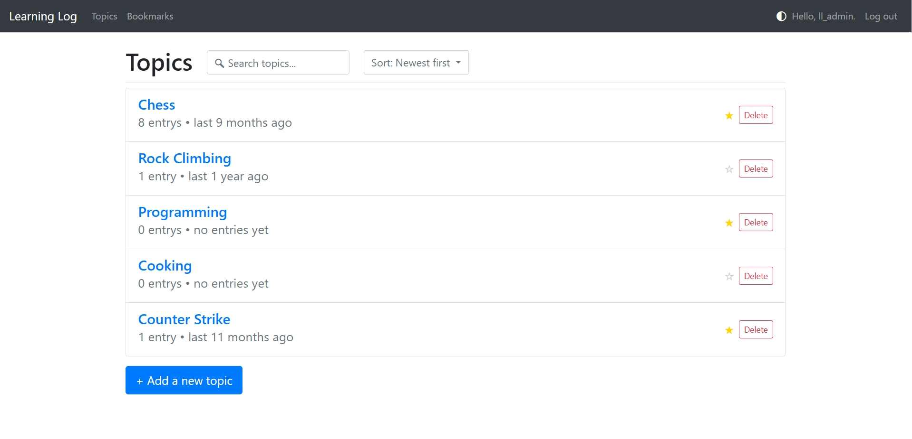
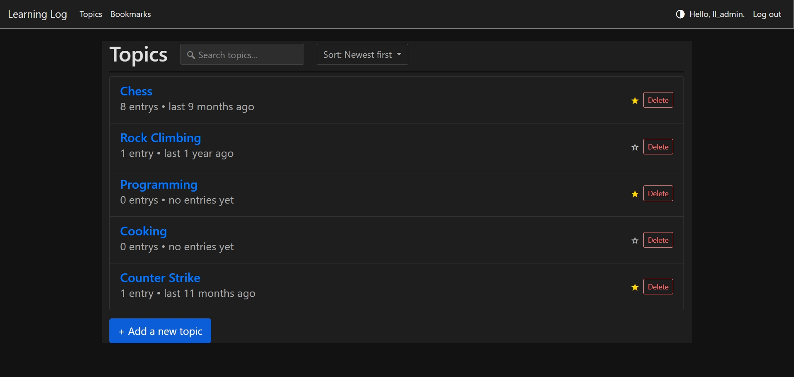
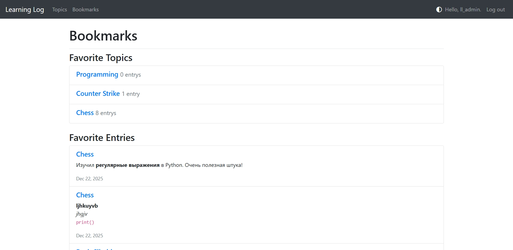

# 📚 Learning Log

> **A personal knowledge management web application for students and self-learners.**
> Organize your study materials by topics, write formatted notes with Markdown, and revisit what matters most with the **Favorites** feature.
> Perfect for active learning, spaced repetition, and building your own digital second brain.

---

## ✨ Features

- **🗂️ Topic-based organization** — Group notes under custom topics (e.g., "Python", "Calculus", "Django").
- **📝 Markdown support** — Write richly formatted notes with bold, italics, code blocks, lists, and links.
- **👁️ Live preview** — See how your note will look while editing, without leaving the form.
- **🔍 Search & sort** — Instantly find topics or entries; sort by date (newest/oldest) or alphabetically.
- **🖍️ Highlight on search** — Matched words are highlighted in entries for quick navigation.
- **⭐ Favorites (Bookmarks)** — Star important topics or entries for quick review.
- **💾 Export & import** — Backup or share your knowledge as JSON files.
- **😊 Emoji picker** — Insert emojis directly into your notes.
- **🌙 Dark / Light mode** — Switch themes with one click, saved across sessions.
- **📱 Responsive design** — Works great on desktops, tablets, and phones.

---

## 🖼️ Screenshots

| Light Theme | Dark Theme | Favorites |
|:-----------:|:----------:|:---------:|
|  |  |  |

---

## 🛠️ Tech Stack

| Layer | Technology |
| :--- | :--- |
| **Backend** | Python, Django |
| **Frontend** | HTML5, CSS3, Bootstrap 4, Vanilla JavaScript |
| **Database** | SQLite (development), PostgreSQL-ready |
| **Libraries** | `markdown`, `django-bootstrap4`, `marked` (JS) |
| **Deployment** | Ready for Heroku, Render, Railway, or any WSGI server |

---

## 🚀 Quick Start

### 1. Clone the repository

```bash
git clone https://github.com/your-username/learning-log.git
cd learning-log
```

### 2. Set up a virtual environment
```
python -m venv venv
source venv/bin/activate      # Linux / macOS
venv\Scripts\activate         # Windows
```

### 3. Install dependencies
pip install -r requirements.txt
